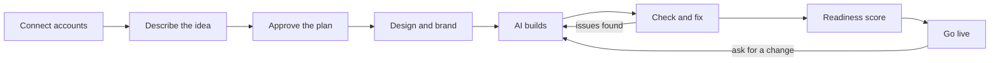

# 03 — User journey and platform screens

## The journey

The user makes every decision in steps A–D. The platform does E–H and keeps fixing until checks pass. Later changes go back through the same build-and-check loop.

## Step by step

### 1. Sign up and connect accounts

- Sign in to Nexora (email or Google).
- **Connect AI keys.** At least two free keys required (e.g. Gemini + NVIDIA NIM). Each key is tested on entry with a tiny call; the UI shows provider, models found and detected limits. Show plainly: "Free tiers may use your prompts to train models. Don't put private customer data in your description."
- **Connect Supabase** (OAuth, one click). Show free-plan facts: 2 active projects max, pause after 7 days of inactivity. Check free slots before creating a project.
- **Connect GitHub** (GitHub App, access limited to repos Nexora creates).
- **Connect Vercel or Netlify** (can be deferred until "Go live").

### 2. Describe the idea

- One large text box: "Describe your app in your own words." Example placeholder from a real use case (college inventory).
- Optional uploads: logo, screenshots, design references, documents.
- Optional quick fields: app name, who uses it, must-have features.

### 3. Approve the plan

The AI returns a product plan rendered as plain-language cards, not JSON:
- Who uses it (roles) and what each role can do
- The data it keeps (entities and fields)
- The pages (list, detail, form, dashboard, custom)
- The dashboard KPIs
- Integrations and notifications
- Anything the AI assumed, flagged for confirmation

The user edits inline ("employees can't delete equipment"), asks questions, then approves. Nothing is built before approval.

### 4. Design and brand

1. **Recommended first.** Show 3 styles recommended for this app type (e.g. inventory → Executive cobalt, Airy pill, Industrial dark), rendered on the user's own dashboard with their entity names and KPI cards.
2. **Browse all 18 styles** in a gallery, same live preview.
3. **Pick a palette** from 14, or upload a logo / enter brand colors to generate a personal palette. Any palette works with any style.
4. **Fine-tune:** light/dark default, density, corner radius, font pair, motion level (Off, Subtle, Expressive).
5. **Brand kit preview:** favicon at real sizes, browser tab mock, login page, email header, link-preview card.

All of this is computed in the browser from tokens; zero LLM calls.

### 5. Build (with live progress)

- Before starting, show the estimate: "This app needs about 1.5M tokens. With your 3 keys it should finish in about 3 hours. Add a free Groq key to cut that to about 2 hours."
- A task list shows stages: database, auth, screens, custom logic, checks, fixes.
- Live preview updates as screens are generated.
- If all keys are exhausted: "65% done. Paused until 12:30 PM IST when your Gemini limit resets. We'll continue automatically." Optional email/push when done.

### 6. Check, fix, score

- Checks run automatically; failures go to the fix loop.
- The readiness score appears with category breakdown and findings in plain language, each with "Fix it for me" where possible.

### 7. Go live

- Commit to GitHub, apply migrations to Supabase, deploy to Vercel/Netlify.
- Setup checklist for anything the user must do (e.g. "Add your email service key to send notifications").

### 8. Change it later

- A chat box on the project: "Add a dark mode", "Show monthly revenue on the dashboard".
- The platform updates the spec, regenerates affected parts, runs checks, and opens a GitHub pull request with a plain-language summary. User approves to merge and redeploy.

## Platform screens

| Screen | Purpose |
| --- | --- |
| Landing / sign in | Explain the product; sign in |
| Onboarding: connect | AI keys, Supabase, GitHub, host |
| Settings: keys and accounts | Add/remove keys, see limits and today's usage per provider |
| New project: describe | Idea input and uploads |
| Plan review | Editable plan cards, approve button |
| Design studio | Style gallery, palettes, brand upload, fine-tune, brand kit preview |
| Build progress | Stages, live preview, pause/resume state, ETA |
| Project dashboard | Tabs below |

### Project dashboard tabs

| Tab | Shows |
| --- | --- |
| Overview | App description, status, live link, readiness score summary |
| Preview | Live app in an iframe, device-size switcher |
| Features | Everything the spec contains, as plain cards |
| Design | Current style, palette, brand kit; switch or tweak |
| Code | File tree and viewer; link to GitHub repo |
| Integrations | Connected services and keys used by this app |
| Activity | What the AI did and when |
| Issues | Open problems from checks, with fix actions |
| Quality | Readiness score by category, findings |
| Deployment | Hosting status, environment variables checklist, deploy history |

## Platform UI itself

The Nexora platform uses its own design system: style `airy-pill` with palette `sky`, exactly as defined in `design/`, in light and dark modes. Keep the platform calm so the user's app previews stand out.
