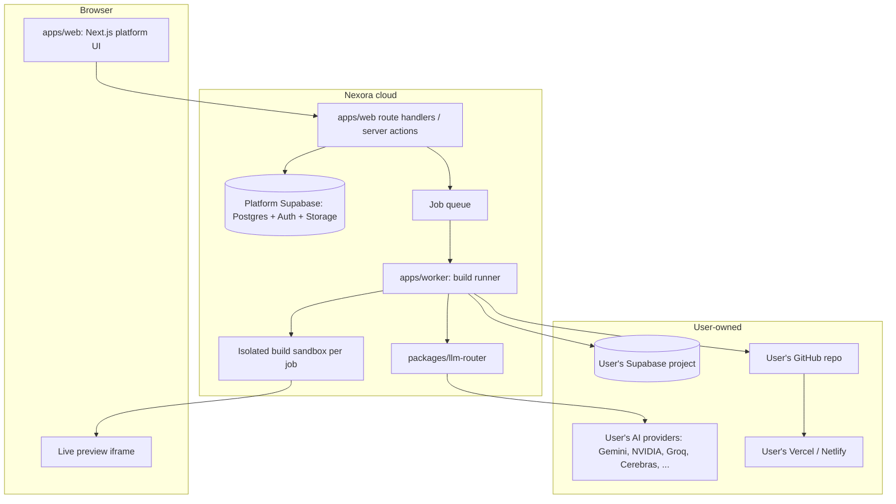

# 04 — Architecture

## System overview



## Monorepo layout

```
apps/
  web/                 Platform UI and API (Next.js)
  worker/              Build job runner; owns sandboxes
packages/
  spec/                ProductSpec Zod schemas, versioning, diffing
  llm-router/          Provider registry, adapters, rate buckets, routing, failover, cache
  generator/           Deterministic code generation from ProductSpec + templates
  checks/              Check runners (tsc, eslint, vitest, playwright, axe, lighthouse, audit, RLS lint)
  readiness/           Score computation from check results
  design-tokens/       Loads design/*.json, resolves style + palette + brand into CSS variables
  brand-kit/           Logo color extraction, palette generation, contrast fixing, favicons, OG images
  motion/              Our own animation and background components (no third-party copies)
  integrations/        Supabase Management API, GitHub App, Vercel/Netlify clients
  vault/               Encryption/decryption of user secrets
  ui/                  Shared platform UI components (shadcn-based)
templates/
  app-starter/         Base Next.js + Supabase app every generated project starts from
  blocks/              Template blocks: crud-list, crud-form, detail, dashboard, auth, settings, empty-state...
design/
  styles.json, palettes.json, fonts.json
docs/
```

## Main components

### apps/web
- Next.js App Router. Server components by default; client components only for interactivity.
- Auth via platform Supabase. All platform tables have RLS keyed to `auth.uid()`.
- Never runs builds or LLM calls in request handlers; enqueues jobs.
- Streams build progress to the browser (Supabase Realtime on `build_events` or server-sent events).

### apps/worker
- Pulls jobs from the queue; runs the generation pipeline (doc 06) step by step.
- Each step is idempotent and writes a checkpoint, so a build can stop at any point and resume.
- Runs generated code only inside an isolated sandbox (no network except package registry and the user's Supabase/LLM endpoints; CPU, memory and time limits).
- Sleeps a build when the router reports all providers exhausted, and re-enqueues it for the earliest reset time.

### Job queue
- Must be durable, support delayed jobs (resume at a time), retries with backoff, and concurrency limits per user.
- Recommended default: a Postgres-backed queue in the platform database (e.g. pg-boss). Alternative: a hosted workflow engine. See open questions.

### Build sandbox
- One sandbox per build: install, build, run tests, serve preview.
- Recommended default: containers on a worker host we control. Alternatives: a hosted sandbox service. See open questions.

## Platform data model (first pass)

| Table | Key columns | Notes |
| --- | --- | --- |
| `profiles` | id (= auth uid), name, timezone, locale | Timezone used for ETAs and reset times |
| `provider_keys` | id, user_id, provider, label, encrypted_key, key_fingerprint, status, last_tested_at | Encrypted by `packages/vault`; key never returned to client |
| `provider_limits` | key_id, model, rpm, tpm, rpd, tpd, source (docs/headers/observed), updated_at | Learned live |
| `provider_usage` | key_id, model, window_start, requests, input_tokens, output_tokens | Rolling windows for buckets |
| `connections` | id, user_id, kind (supabase, github, vercel, netlify), encrypted_tokens, scopes, account_label, status | OAuth tokens encrypted |
| `projects` | id, user_id, name, description, status, supabase_ref, github_repo, host_project, live_url | |
| `project_assets` | id, project_id, kind (logo, image, doc, screenshot), storage_path | Platform Storage |
| `specs` | id, project_id, version, spec_json, approved_at | Immutable versions; diff between versions |
| `design_choices` | project_id, style_id, palette_id or brand_palette_json, font_pair, density, radius, mode, motion_level | |
| `builds` | id, project_id, spec_version, kind (initial, change), status, progress, eta, paused_until | |
| `build_steps` | id, build_id, name, status, attempt, checkpoint_json, started_at, finished_at | Resumable units |
| `build_events` | id, build_id, ts, level, message | Plain-language activity feed |
| `llm_calls` | id, build_id, step_id, provider, model, prompt_hash, input_tokens, output_tokens, latency_ms, outcome | No prompt text with secrets; prompt bodies optional and redacted |
| `llm_cache` | prompt_hash, model_class, response, created_at | Re-generation costs nothing |
| `check_results` | id, build_id, check, status, findings_json | |
| `readiness_scores` | build_id, total, by_category_json, findings_json | |
| `change_requests` | id, project_id, text, spec_diff_json, build_id, pr_url, status | |

## Key flows

- **New project:** describe → `specs` v1 draft (LLM) → user edits → approve → design choice → enqueue `builds(initial)`.
- **Build:** worker runs pipeline steps; each step writes checkpoint; events stream to UI.
- **Pause/resume:** router throws `AllProvidersExhausted(resumeAt)` → worker marks build `paused_until` → queue delays job to `resumeAt`.
- **Change request:** text → LLM produces spec diff → user confirms → build(change) regenerates affected files → checks → PR.

## Non-functional requirements

- A single user's build must never block other users: per-user concurrency limits.
- Builds survive worker restarts (checkpoints + durable queue).
- All user secrets encrypted at rest; decrypted only inside the worker for the duration of a call.
- Observability: structured logs with build_id; no secrets or full prompts in logs.
- Platform cost: users pay for AI via their keys; Nexora pays for hosting, workers and sandboxes. Track sandbox minutes per build.
